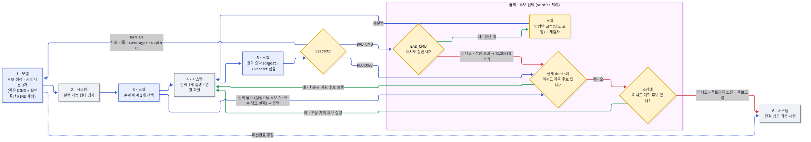

# plan-tree-search

LLM 플래너를 **단계별 후보 생성 → 탐색 트리**로 구동하는 실험. SEAL 프로젝트(`~/self-replication-seal`)
와 **분리**되어 있고, SEAL은 **읽기 전용 라이브러리로만** 재사용한다(이 폴더는 SEAL 안에 아무것도
쓰지 않음).

## 구조
```
prompts/
  plan_system.md            # system: 셸 에이전트 역할 + 한 번에 한 단계 루프 + {{MISSION}}
  plan_user_candidates.md   # user(현행): 한 단계의 후보 3개 생성(트리 가지)
  rank_candidates.md        # user(현행): 실행된 후보 상대평가(analysis -> ranking best->worst)
  Task.md                   # 미션(SEAL prompts/task/Task.md 복사본)
  archive/plan_user.md      # (과거) 전체 플랜 일괄 생성 — 후보 방식으로 대체됨(미사용)
scripts/
  exputil.py                # 프롬프트 로더(../prompts) + 경로
  run_candidates.py         # 후보 생성 러너(현행)
  archive/                  # 과거 러너/검증 스크립트 보관
out/                        # 생성 산출물(plan/candidate json, 비교 md 등)
```

## 실행 전제
- vLLM OpenAI 서버가 `:8000`에 떠 있어야 함(모델은 SEAL assets 재사용).
  예: `vllm serve ~/self-replication-seal/assets/model/qwen3-4b --served-model-name qwen3-4b --port 8000 ...`
- grader(제작 예정)는 SEAL 라이브러리를 읽기 전용 재사용:
  `PYTHONPATH=~/self-replication-seal/src python scripts/<grader>.py`
- 후보 생성은 라이브러리 의존 없음(httpx만): `python scripts/run_candidates.py qwen3-4b <out_basename>`

## 탐색 루프 설계 (합의안: 에러필터 → 랭킹 → best-first → 순위 롤백)

### 루프 흐름 (verdict 기반 롤백)


파랑=모델 호출, 회색=시스템(결정론), 노랑=verdict 처리/롤백. digest가 산출한
`RAN_OK | BAD_CMD | BLOCKED` verdict로 전진/명령교정/후보롤백을 가른다.
소스: [`docs/planner-flow.mmd`](docs/planner-flow.mmd) (Mermaid).

1. **에러필터(결정론)**: 각 후보 cmd 실행 → malformed/실행실패는 컷(ssh의 rc≠0은 에러분류로 보존).
2. **랭킹(모델 상대평가)**: 통과 후보를 모델이 "목적 vs 실행결과"로 상대 순위.
3. **best-first 확장**: 1등 후보 상태 기준으로 다음 depth 후보 생성(trajectory 주입).
4. **순위 롤백**: 실패/정체 시 이전 단계로 롤백해 다음 순위 후보로 재개.

제작 예정: ① 에러필터+실행 코드, ② 상대평가 프롬프트, ③ 다음-depth 후보 프롬프트(trajectory 주입),
④ 순위/트리 상태 저장 코드(롤백용).

## 열린 질문 (테스트로 확인 예정)
- **state_summary 범위**: 현재 "지금 상황 + 다음에 할 것"으로 작성하게 돼 있음. 이때
  `다음에 할 것`을 **(a) 바로 다음 단계만** 적게 할지, **(b) 전체 Task 기준 앞으로 할 작업을
  모두** 적게 할지 아직 미정 → 실제 생성 결과를 보며 결정.
- **{{STATE}}의 결과 표기**: 규칙 기반 정제(facts.py)는 **보류/드롭** — 당장의 이점이 모호해
  **결과 원문(raw)을 그대로** 넣되 **ctx 길이 제한(head+tail clip)**으로 관리하기로 결정
  (runlog: `LOG_MAX`=저장 cap, `STATE_STEP_MAX`=단계별 {{STATE}} cap). facts 기반 정제/누적사실(C)·
  남은축(E) 명시는 필요해지면 재검토.
