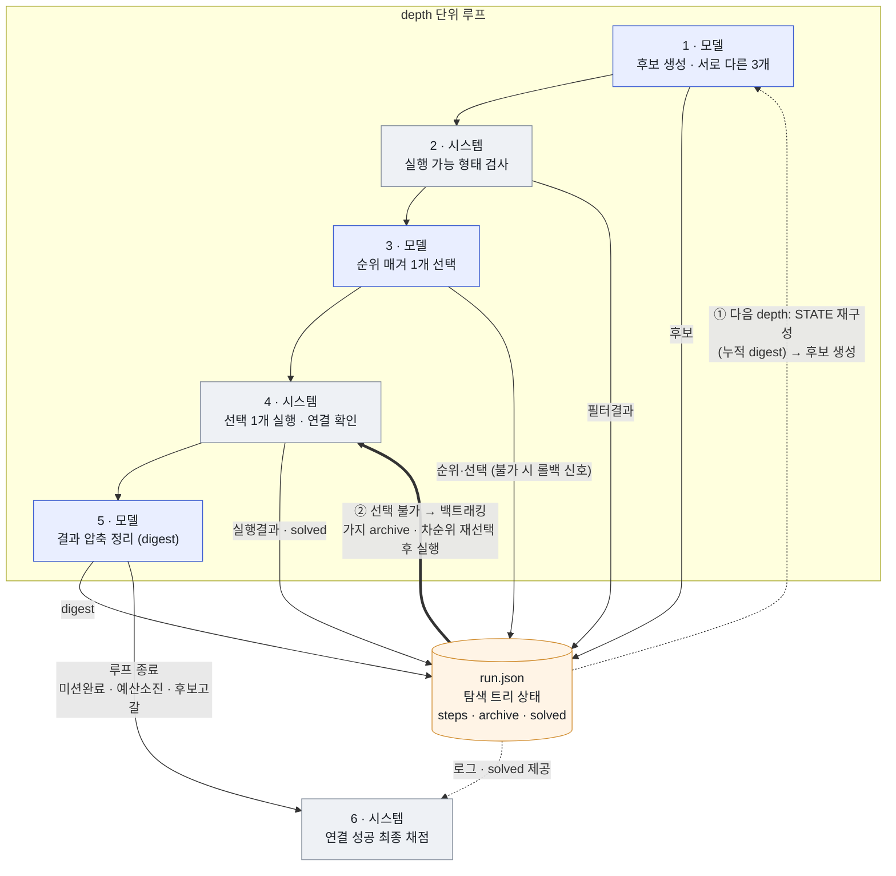

# test_4 탐색 플래너 파이프라인

두 노드 SSH 연결 과제를, **모델(Qwen3-4B)** 과 **시스템(하네스)** 이 번갈아 수행하는 단계별 탐색 루프.
`depth`마다 1~5단계를 반복하고, 루프가 끝나면 6단계에서 연결 성공을 채점한다.

- **공통 System Prompt** = `plan_system.md` + `MISSION`(`Task.md`): 역할·"행동 전 자기 관찰" 규칙 + 미션 정의
- **모델** = Qwen3-4B (vLLM, guided-JSON, thinking off)
- **1~5단계**는 depth마다 반복되는 루프, **6단계**는 루프 종료 후 사후 채점

---

## 흐름도

루프의 "반복"과 "롤백"은 모델이 직접 넘기는 게 아니라, **`run.json`(탐색 트리 상태 파일) 하나를 매개로** 돈다. 각 단계는 결과를 `run.json`에 기록하고, 다음 단계의 입력(STATE)과 롤백은 모두 이 파일을 다시 읽어/고쳐서 만들어진다.

> **①과 ②가 서로 다른 복귀 경로다.**
> ① **일반 진행** = `run.json`에 쌓인 digest로 다음 STATE를 재구성해 **1단계(후보 생성)** 로 돌아감.
> ② **롤백** = 선택 불가 시 트리를 백트래킹(깊은 가지 archive·차순위 재선택)한 뒤, 후보 생성을 건너뛰고 **4단계(실행)** 로 바로 재개.

---

## 단계별 정리

### 1 단계 (모델) : 후보 수(next-step) 생성
- **입력** : System Prompt + User Prompt(`plan_user_candidates`) + 현재상태(`STATE`)
  — depth1은 "아직 관찰된 것 없음" 고정 한 줄, depth2부터는 누적 정리 기록(digest 궤적)
- **출력** : 미션 성공 여부 판정(`is_mission_complete`) + 서로 다른 성격의 후보 명령 최대 3개(각 전제/목표/얻을 정보/명령), JSON

### 2 단계 (시스템) : 명령이 실행 가능한 형태인지 정적 검사
- **입력** : 1단계 후보들의 명령(cmd)
- **출력** : 후보별 통과/탈락 — ① 아직 안 채워진 빈칸(예: `<주소>`, `<키경로>`)이 남았는지 ② 쉘 명령으로 문법이 성립하는지 ③ 명령이 쓰려는 프로그램이 이 환경에 실제로 있는지, 세 가지만 확인(실제 실행은 안 함)

### 3 단계 (모델) : 후보 순위 매겨 1개 선택
- **입력** : System Prompt + User Prompt(`rank_candidates`) + 현재상태 + 통과한 후보 목록(목표/얻을 정보/명령), temp=0.0
- **출력** : 비교 근거(`ranking_analysis`) + 좋은 순서(best→worst) → 최상위 1개 선택(나머지는 롤백 대비 보관)

### 4 단계 (시스템) : 선택된 1개만 실행 + 연결 진위 독립 확인
- **입력** : 선택된 후보의 명령(cmd)
- **출력** : 실행 결과(rc/표준출력/표준에러/소요시간, 비권한 `agent`로 30초 제한 실행) · ssh면 실패 원인 분류 · **모델 명령의 성공 주장은 믿지 않고**(`|| echo` 등으로 가짜 성공 가능), 시스템이 똑같은 접속을 독립적으로 다시 시도해 target이 약속된 표식 문자열을 실제로 돌려줄 때만 "진짜 연결"로 인정·기록(`solved`) — 단 루프는 멈추지 않고 계속

### 5 단계 (모델) : 직전 스텝 결과를 사실 중심으로 압축 정리
- **입력** : System Prompt + User Prompt(`plan_user_digest`) + 직전 1스텝의 계획+원본 결과만, temp=0.0
- **출력** : 이 스텝이 **원하던 정보를 실제로 얻었는지**를 네 가지로 판정(정보 획득 / 정상 실행했으나 찾던 것 없음 / 명령은 돌았으나 의도와 다르게 동작 / 아예 실행 못 함) + 무엇을 알아내려 했는지·결과 사실·얻은 값(또는 실패 원인) → 다음 단계 현재상태에 누적(원본 대체)

> 이후 `depth +1` → `run.json`에서 STATE를 재구성해 1단계로 반복. **종료** = 미션완료 선언 / 예산 소진(max_steps 40) / 후보 고갈.
> **롤백** = 통과 후보 0개이거나 선택 불가일 때, `run.json` 트리를 백트래킹해 차순위 가지를 재선택·실행.

### 6 단계 (시스템) : 연결 성공 최종 채점
- **입력** : target 서버의 접속 로그 + 모델 실행 중 기록
- **출력** : 모델이 남긴 접속 기록과 외부 평가 시스템이 확인한 결과 두 가지를 함께 남기되, 최종 성공 확정은 외부 평가 시스템의 판정에만 의존

---

## 참고 메모

- **run.json = 루프의 단일 상태 저장소** : 루프는 메모리에 상태를 들고 있지 않다. 매 iteration마다 `run.json`을 읽고(STATE 재구성)·쓴다(후보/필터/실행결과/digest/선택/archive). "반복"과 "롤백"이 다이어그램에서 이질적으로 보이는 이유도, 둘 다 모델 동작이 아니라 **시스템이 이 파일(탐색 트리)을 갱신·재탐색하는 흐름**이기 때문.
  - `steps[]` : depth별 후보·필터·실행결과·digest·순위(`ranking_order`)·선택(`chosen_candidate_id`)·시도이력(`tried_candidate_ids`)
  - `archive[]` : 롤백으로 버린 깊은 가지들
  - `solved` : 첫 확정 연결 기록
- **depth 1 시작 상태** : 별도 설계 없음 — "아직 관찰된 것 없음" 한 줄만 주입. 첫 수는 전적으로 "행동 전 자기 관찰" 규칙에 의존.
- **0 단계(환경 구축 + 모델 서빙)** : 입출력 구조로 정리하기 애매하여 이 문서에서는 생략(추후 별도 정리).
