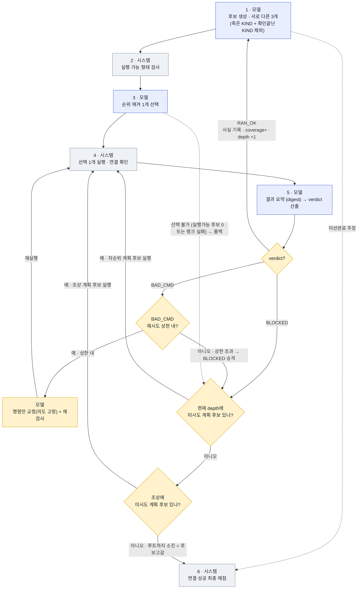

# Verdict → 트리 동작 매핑 설계 (verdict-driven rollback)

작성 대상: 이 변경을 구현할 사람(설계 논의 중인 본인 / 후속 세션). 상태: **설계 확정, 미구현**. 2026-10-27.

목적: digest의 `verdict`를 탐색 트리의 **전진/롤백 트리거**로 연결해, "구조는 있으나 거의 안 걸리는" 롤백을 실제로 작동시킨다. verdict는 **단일 스텝 판단**(RAN_OK/BAD_CMD/BLOCKED)만 맡고, "계획 변경"은 **coverage 배제 + 롤백**이라는 트리 구조가 처리한다.

---

## 1. 배경 — 현재(as-is) 문제

- **verdict 미사용**: [loop.py:85](../scripts/loop.py#L85) `_make_digest`가 verdict를 만들지만 [loop.py:93](../scripts/loop.py#L93)에서 **무조건 `depth += 1`**. 실행 품질과 무관하게 항상 전진.
- **롤백 트리거가 실행품질 기반 아님**: (1) gen 실패, (2) rank `out=None`(선택 불가)뿐. 실행한 명령이 쓸모없어도 롤백 안 됨 → **백트래킹 없는 일직선**(seed3가 `ls ~/.ssh` 29회).
- **KIND 단위 deadend 없음**: `tried_candidate_ids`(후보 id 단위)만 존재([runlog.py:147](../scripts/runlog.py#L147)). strategy_class/move_class는 SEAL 잔재였고 **내재화 안 됨** → 새로 구현 필요.

기존 롤백 기계(재사용): `rollback(failed_depth)`가 failed_depth→root로 **미시도(차순위) 계획 후보가 있는 가장 깊은 depth**를 찾아 그 아래를 archive하고 재선택. `resume=chosen+1` 반환, 없으면 `None`([runlog.py:132](../scripts/runlog.py#L132)). **한 호출이 "현재 depth → 조상 → 소진" 순으로 탐색** = 아래 그림의 SIB→ANC→후보고갈.

---

## 2. to-be 플로차트 (확정)

★=1단계 신규. 노드 색: 모델(파랑)/시스템(회색)/신규(노랑).



> SIB·ANC는 **한 `rollback()` 호출**의 두 단계(현재 depth→조상). S3 "선택 불가" 엣지도 같은 `rollback()`으로 진입한다.

---

## 3. verdict 스키마 (4 → 3)

| 현재(4) | 변경(3) | 근거 |
|---|---|---|
| INFO_GAINED | **RAN_OK** | 존재/부재 모두 "신뢰 가능한 사실 획득" → 병합 |
| RAN_BUT_EMPTY | **RAN_OK** | (부재도 정보. 둘을 가르는 건 거짓 이분법) |
| BAD_CMD | **BAD_CMD** | 실행됐으나 의도한 명령 아님 |
| BLOCKED | **BLOCKED** | 도구 자체가 실행 안 됨 — **rc 127/126이면 코드가 확정**(`_enforce_blocked_floor`). ⚠️ **rc 124(타임아웃)는 BLOCKED 아님 → BAD_CMD**(도구 없음이 아니라 "너무 느림"=명령 축소로 고칠 일. 전체 method를 죽이면 안 됨). |

- `RAN_OK`의 `learned`에 **확립된 사실(존재 또는 부재)** 서술. 예: "key absent from ~/.ssh".
- 모델은 사실상 **BAD_CMD vs RAN_OK 이진**만 판단(BLOCKED는 rc로 코드가 결정).

---

## 4. verdict → 트리 동작 매핑

| verdict | 트리 동작 | deadend 입도 | 전진? |
|---|---|---|---|
| **RAN_OK** | 사실 기록 + **coverage 등록** → **다음 깊이 전진** | — | O (`depth+=1`) |
| **BAD_CMD** (상한 내) | **FIX**: 의도 3필드 고정, **`cmd`만 전용 호출로 재생성** → S2 재검사 → S4 재실행 | **명령 KIND** | X (같은 depth) |
| **BAD_CMD** (상한 초과) | **BLOCKED로 승격** → SIB | 명령 KIND | X |
| **BLOCKED** | **SIB**(현재 depth 차순위) → 없으면 **ANC**(조상) → 없으면 **후보고갈** | **방법/도구 KIND** | X |

핵심 원칙: **RAN_OK만 전진.** BAD_CMD·BLOCKED는 둘 다 "이 스텝을 다시"지만 **비대칭**:
- **BAD_CMD = 계획 유지·명령만 교정**. 형제 풀엔 "같은 의도의 교정본"이 없으므로 **전용 명령교정 호출**로 `cmd`만 다시 쓴다(전체 re-gen 아님 — 그러면 멀쩡한 의도를 버려 BLOCKED와 동작이 같아짐). 상한 초과 = "이 의도로는 명령을 못 만든다" → BLOCKED 승격.
- **BLOCKED = 접근이 막힘·계획 변경**. 기존 `rollback()`으로 **차순위 계획 후보**(현재 depth→조상) 실행.

> deadend는 반드시 **KIND 단위**(리터럴 추상화). 안 그러면 "같은 전략 다른 숫자"로 재고착(리터럴 변주 문제).

---

## 5. 제어 흐름 (as-is → to-be)

### as-is (요약)
```
for it in 1..max_steps:
    gen @depth → prepare → rank(out)
    if out is None: rollback(depth); depth = resume-1
    execute_one(chosen); make_digest(...)   # verdict 버려짐
    depth += 1                                # 항상 전진
```

### to-be (제안)
```
retries  = {}             # depth -> BAD_CMD 교정 횟수
deadends = per-depth {command_kinds, method_kinds}
covered  = set()          # 이미 확립된 사실 KIND (coverage)
depth, mode = 1, GEN      # mode: GEN(새 depth 생성) | EXEC(선택된 후보 실행)

while steps_used < max_steps:
    if mode == GEN:
        cands = gen(depth, exclude = deadends[depth].all() ∪ covered)   # S1
        if cands.is_mission_complete: status = complete_claimed; break
        prepare_depth(depth)                                            # S2 정적필터
        rl, out = rank_depth(depth)                                     # S3
        if out is None:                       # 실행가능 후보 0 또는 랭크 실패 → 롤백
            depth, ok = do_rollback(depth);  if not ok: status=exhausted; break
            mode = EXEC; continue
        chosen = rl.step(depth).chosen

    execute_one(depth, chosen)                                          # S4
    v = make_digest(depth, chosen).verdict    # S5 (BLOCKED는 rc로 코드 확정)

    if v == RAN_OK:                                                     # 전진
        if solved: record
        covered.add(fact_kind(digest.learned))
        depth += 1; mode = GEN

    elif v == BAD_CMD:
        deadends[depth].command_kinds.add(cmd_kind(chosen))
        if retries[depth] < BAD_CMD_RETRY_MAX:                         # 상한 내 → FIX
            retries[depth] += 1
            chosen = fix_command(chosen, digest,                        # 의도 고정, cmd만 재생성
                                 exclude = deadends[depth].command_kinds)
            prepare_one(chosen)               # S2 재검사
            mode = EXEC                        # 같은 depth 재실행
        else:                                  # 상한 초과 → BLOCKED 승격
            v = BLOCKED

    if v == BLOCKED:                                                    # 차순위/조상 롤백
        deadends[depth].method_kinds.add(method_kind(chosen))
        depth, ok = do_rollback(depth);  if not ok: status=exhausted; break
        mode = EXEC
    steps_used += 1

# do_rollback(d): resume = rl.rollback(d)       # 현재→조상 미시도 후보 탐색
#                 return (d, False) if resume is None else (resume-1, True)  # 재선택 후보는 mode=EXEC로 실행
```

변경 지점: **(A)** execute 직후 `depth+=1`을 verdict 분기로 교체(RAN_OK만 전진). **(B)** gen에 `exclude=deadend+covered` 인자. **(C)** BAD_CMD = `fix_command` 전용 호출(의도 고정), 상한 초과 시 BLOCKED 승격. **(D)** BLOCKED·선택불가 = 기존 `rollback()` 재사용(현재→조상).

---

## 6. 데이터 스키마

### 6.1 digest (step.digest, *.digest.jsonl)
```
{ "intended": str, "observed": str,
  "verdict": "RAN_OK" | "BAD_CMD" | "BLOCKED",
  "learned": str,   # RAN_OK: 확립된 사실(존재/부재). 그 외: ""
  "note":    str }  # RAN_OK 아니면 무엇이 틀렸나(사실만)
```

### 6.2 deadend — scope 구분 (중요)
- **method_kinds = run 전역**: 도구 없음은 **에피소드 전체** 속성(5번 스텝에 ping 없으면 30번에도 없음). BLOCKED가 등록 → 이후 **모든 gen에서 제외**. → `run.json` 최상위 `method_kinds_dead: [str]`. (환경은 run 내 불변이라 "나중에 쓸 수 있는데 막힘" 문제 없음.)
- **command deadend(BAD_CMD) = 보류**: ⚠️ 리터럴 추상화 `command_kind`는 **교정본까지 막는다**(`ssh target@<ip>` 서명이 깨진 것·고친 것을 동일시) → 1단계 제외. 대신 **fix_command에 "이 depth에서 이미 시도한 정확한 명령 문자열"만 넘겨 반복 방지** + `RETRY_MAX`.
- step 레벨엔 `retry_count: int`(이 depth BAD_CMD 교정 횟수)만.
- 기존 `tried_candidate_ids`(id 단위 롤백 장부)는 유지 — deadend와 별개 축.

### 6.3 run 전역 — 추가
```
"covered": [str]    # 이미 확립된 사실 KIND (RAN_OK가 등록). S1 생성 시 제외.
```

### 6.4 move/fact KIND 정규화 (신규 — 구현 필요)
- **method_kind** = 주 프로그램/행위: `ping` / `ssh-sweep` / `ssh-single` / `find` / `ls` / `cat` ...
- **command_kind** = method_kind + 인자 리터럴 추상화 서명(IP→`<ip>`, 경로→`<path>`, 범위→`<range>`). 예: `for ip in <range>; ssh target@<ip>`.
- **fact_kind**(coverage용) = `learned`를 정규화한 사실 키(예: `key@~/.ssh=absent`, `self_ip=10.77.1.2/28`). 입도는 §8-열린점.
- 최소안 = 코드 regex 서명. (SEAL strategy_class/move_class 이식 안 됨 — 새로 구현.) **method_kind는 기존 [errorfilter.py `programs()`](../scripts/errorfilter.py#L34)(shlex 프로그램 단어) 재활용 가능 — 새로 쓸 건 command_kind 서명뿐.**

### 6.5 상수
```
BAD_CMD_RETRY_MAX = 2       # 같은 depth 명령 교정 상한 (초과 시 BLOCKED 승격)
```

---

## 7. "선택 불가 → 롤백" 엣지는 유지 (확인 완료)

[rank_candidates.py:49-51](../scripts/rank_candidates.py#L49)에서 `out=None`은 **두 경우에 발생, 둘 다 현행 유효**:
1. **정적 필터 통과 후보 0개**(`not cands_ok`) — 생성된 3개가 전부 실행 불가 형태.
2. **랭크 모델 호출 실패**(재시도 후 파싱 불가).

실행 **전** 롤백 트리거로, BLOCKED(실행 **후**)와 진입 시점이 다른 별개 경로. **새 설계에선 더 중요**: S1에서 deadend+covered를 빼다 보면 쓸 후보가 0이 되는 상황이 늘고, 이 엣지가 "여기선 더 할 게 없음 → 조상 롤백"을 **stall 카운터 없이** 발동시킨다. → **유지.**

---

## 8. 레벨3 "계획 변경" 처리 — stall 카운터 없이

> **[상태: coverage 배제는 1단계 보류. 실험 후 결과 보고 도입 여부 결정.]** 이 절의 "RAN_OK 반복 방지"는 보류 후보다. 1단계는 deadend(BAD_CMD/BLOCKED)만으로 가고, RAN_OK 반복이 실제로 문제가 되는지 먼저 측정한다.

verdict에 "replan"을 넣지 않는다. 대신:
- **RAN_OK 반복 방지 = 생성(사전) 단계에서**: `ls ~/.ssh`가 빈 걸 한 번 확인하면 그 **fact_kind를 covered에 등록** → S1이 **이미 확인한 KIND를 재생성 안 함**. (seed3의 29회 반복 차단.)
- **접근 소진 = 롤백(기존)**: covered+deadend를 빼서 **고를 게 없어지면** → S3 "선택 불가" → `rollback()`으로 **조상 분기로 자동 전환**.

즉 "계획 변경"은 **coverage 배제 + 선택불가 롤백**의 조합으로 자연히 나온다(별도 stall 감지기 불필요).

**정직한 한계**: "반복은 아닌데 유효하지만 무익한 **새** move만 계속"(관련 없는 디렉터리를 매번 새로 뒤짐)은 매 스텝이 새 coverage라 전진만 하고, **예산(max_steps)으로만** 끊긴다. 목표지향 "가까워지나" 판단은 4B에 맡기기 애매해 **지금은 뺀다**(필요 시 후속).

---

## 9. 미결 / 확인 필요
- **move/fact KIND 정규화 수준**: 최소 regex 서명부터 시작할지.
- **fact_kind 입도**(§6.4): 무엇을 "같은 사실"로 묶을지 → covered 정밀도 좌우.
- ~~**`BAD_CMD_RETRY_MAX` 값**~~ → **확정 = 2**.
- ~~**단계 분리**~~ → **확정**: **1단계 = verdict 4→3 + RAN_OK 전진 + BAD_CMD FIX(전용교정) + BLOCKED 롤백 + KIND deadend**. **coverage 배제는 보류**(실험 후 결정, §8). fact_kind도 coverage와 함께 보류.
- **move KIND 정규화 수준**: method_kind=`programs()` 재활용, command_kind=최소 regex 서명부터.

## 10. 리스크
- **FIX 무한루프**: 교정이 같은 명령 재생산 → `RETRY_MAX` + command_kind deadend로 차단 필수.
- **조기 exhausted**: 롤백이 자주 걸리면 미시도 후보 소진이 빨라짐 → 깊이당 후보 수/budget 재점검.
- **deadend/coverage 과배제**: method_kind를 너무 넓게(예: `ssh` 통째) 잡으면 정답 경로 차단; fact_kind를 너무 넓게 잡으면 필요한 재관찰까지 금지. → 입도 신중.

## 11. 변경 파일 (예정)
- `scripts/run_digest.py` — enum 3개.
- `prompts/plan_user_digest.md` — RAN_OK 병합 반영.
- (신규) `prompts/plan_user_cmdfix.md` + `fix_command` 호출 — BAD_CMD 전용 명령교정.
- `scripts/loop.py` — §5 to-be(verdict 분기, FIX 미니루프, retries/covered, do_rollback).
- `scripts/runlog.py` — step `retry_count`/`deadends`, run `covered`.
- `scripts/run_candidates.py` — gen에 `exclude`(deadend+covered) 인자.
- (신규) move/fact KIND 정규화 유틸.

---

## 12. 구현 완료 (2026-10-27) — as-built

1단계 구현 완료. 정적검증(py_compile·순수함수 단위·errorfilter 테스트) 통과, **라이브(vLLM/docker) 미검증**. 아래가 실제 동작이며, 앞 §5 의사코드·§11 목록의 "예정/covered/command_kind" 세부는 이 절로 대체된다.

- **verdict 3개**: `run_digest.DIGEST_SCHEMA` enum = RAN_OK/BAD_CMD/BLOCKED. 프롬프트 `plan_user_digest.md` 3-질문 사다리(INFO+EMPTY→RAN_OK, "부재도 사실").
- **rc 강제** `run_digest._enforce_rc_floor`: 126/127→BLOCKED, **124→BAD_CMD**(타임아웃=명령 축소, method 안 죽임). `_fallback`도 동일.
- **BAD_CMD 교정**: `run_candidates.fix_command`(+ `prompts/plan_user_cmdfix.md`, 스키마 `{change,cmd}`, temp0.0). 입력=의도3필드 고정 + `{{HISTORY}}`(=이 depth의 `[{cmd,note}]`, note는 그 시도 digest에서 재사용). **{{CMD}}/{{NOTE}}/{{TRIED}} → HISTORY 하나로 통합.** `executor.prepare_one`이 cmd 교체+정적필터 재적용.
- **BLOCKED**: `executor.dead_methods(cmd, stderr)`가 죽은 프로그램 추출(stderr의 `X: command not found` 우선=루프 내부 도구도 잡음, 없으면 `programs()[0]`) → **run 전역** `method_dead`에 누적 → `run_candidates.gen(exclude=method_dead)`가 STATE에 "UNAVAILABLE" 주입(소프트 억제).
- **loop.py `run()`**: `mode` GEN/EXEC 상태기계. RAN_OK→depth+1(GEN) / BAD_CMD≤2→fix+prepare_one(EXEC) / 초과→BLOCKED 승격 / BLOCKED→method_dead+`rollback()`(차순위→조상→exhausted). `BAD_CMD_RETRY_MAX=2`. `_make_digest`가 digest 반환. `step.fix_attempts`에 history 적재.
- **보류(미구현)**: coverage/fact_kind(RAN_OK 반복방지), command_kind 영구 deadend. 실험 후 결정.
- **라이브 검증 포인트**: ①새 루브릭이 맨정수류를 실제 BAD_CMD로 잡고 note가 구체적인지 ②fix_command가 의도 유지한 채 교정하는지 ③method_dead 소프트억제로 ping 재제안이 줄어드는지.
